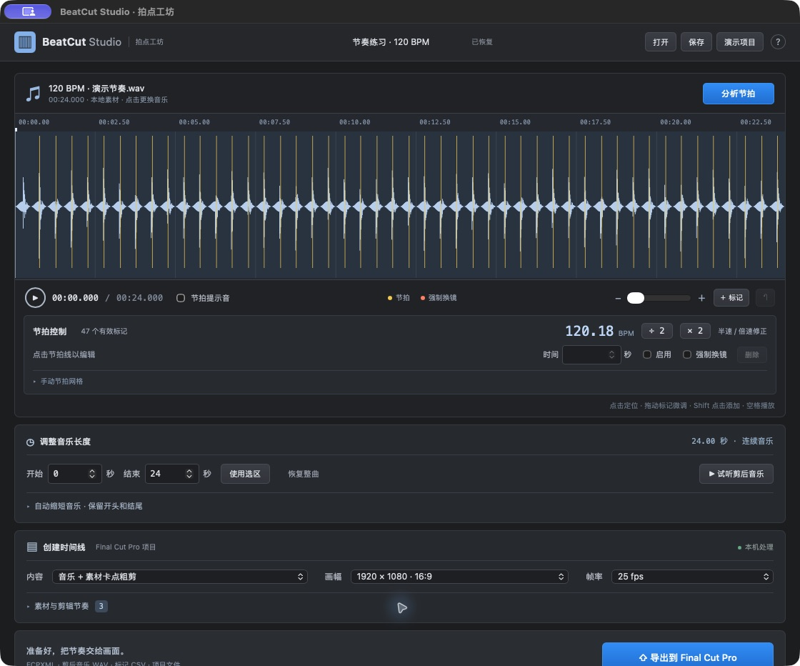
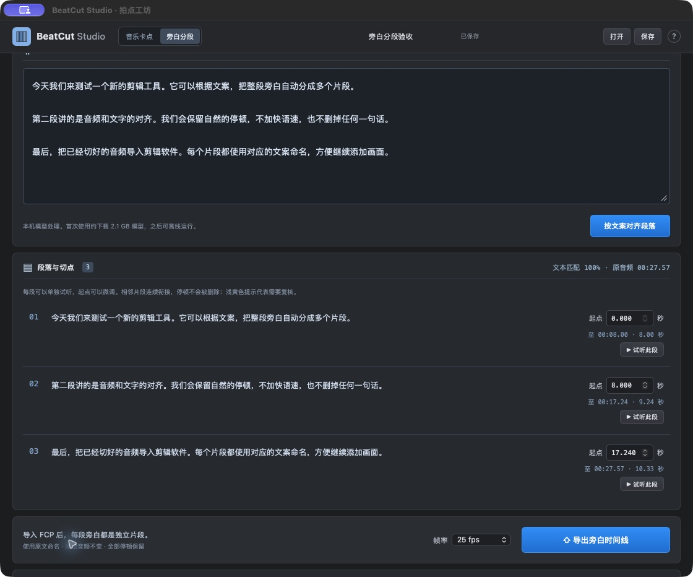

# BeatCut Studio · 拍点工坊

**Local beat markers, music-driven rough cuts and manuscript-based narration splits for Final Cut Pro.**

一首音乐、一组镜头，生成卡点粗剪；一段旁白、一份原文，生成按段落裁切的音频时间线。中文界面，本机运行，MIT 开源，无账号、无付费 API、无遥测。

这是独立实现的开源项目，与 BeatMark、Ulti.Media 或 Apple 无关联。借鉴的是音乐驱动剪辑的工作流程，没有使用商业软件的代码或界面素材。



## 旁白按文案自动分段

在顶部选择 **旁白分段**，导入旁白音频，粘贴生成音频时使用的原文（每段一行，空行忽略）。点击“按文案对齐段落”，逐段试听或微调起点，再导出 FCPXML。FCP 内每段都是以原文命名的独立音频片段。

- 默认保留所有原始音频与停顿；相邻片段连续引用同一音源，不做静音删除、不加速、不重写文案。内部切点对齐项目帧率，音频组件保留全部采样；时间线末尾向上补齐到整帧，最多多出不足一帧的空白，避免 FCP 截掉尾音。
- 支持最长 30 分钟中文旁白；针对 5–20 分钟工作流，以 30 秒音频块和前后上下文处理，再匹配原文段落。
- 使用 Qwen3-ASR + Qwen3-ForcedAligner 的 MLX 实现，仅在 Apple Silicon 本机运行。首次需联网下载约 2.1 GB 模型，完成后离线使用。音频和文案不上传。源码运行旁白模式需额外安装 `requirements-narration.txt`。
- 模型放在 `~/Library/Application Support/BeatCut Studio/models/`，不会写入 Git 仓库。已分析音频会缓存文字时间戳，更改文案后可以复用。
- “文本匹配率”表示原文与识别文字的字符对应比例，并非时间准确度置信分数。漏读、错读、重复、数字念法差异会提示复核；完全无法定位的段落会拒绝生成猜测切点。
- 可保存旁白项目 JSON；恢复后无需重新分析。导出包括 FCPXML、段落时间表 CSV 和项目 JSON。当前不自动移除句间静音。



## 已实现

- 导入 WAV、MP3、M4A、AIFF、FLAC 等音乐，显示可缩放波形。
- librosa 节拍跟踪与 BPM 估计；支持倍速 / 半速重新跟踪、手动 BPM 网格。
- 试听、节拍提示音、拖动 / 新增 / 删除标记、禁用标记、强制换镜、撤销标记修改。
- 选择音乐区间；建议保留首尾的缩短方案，按 4 拍相位与音色相似度排序，可试听拼接。
- 视频和静态图片导入；素材顺序调整、入出点、适应 / 填满、固定首镜和尾镜。
- 每 1 / 2 / 4 / 8 / 16 拍换镜；均匀、渐快、两头快、起伏四种节奏；顺序或固定种子的随机循环。
- 三种 FCPXML：音乐标记、占位剪辑、素材卡点粗剪。
- 横屏 1080p / 4K、竖屏、方形；24 / 25 / 30 / 50 / 60 和精确的 NTSC 分数帧率。
- 同时导出 FCPXML 1.10、剪后音乐 WAV、标记 CSV、项目 JSON；保存并再次打开项目。
- 一键生成可实际播放、分析、导出的本地演示素材。

## Mac App

本机可构建独立的 **BeatCut Studio.app**，内置 Python 分析引擎、FFmpeg 和界面，运行时无需终端、浏览器、Python 或 Homebrew。App 使用原生 macOS 窗口、菜单、文件选择和保存对话框，工作区内嵌 WKWebView；全部计算在本机进行。

当前构建为 **Apple Silicon / arm64**，已在 macOS 27.2 验证。本次所用 FFmpeg 的最低版本为 **macOS 26.0**，因此此构建要求 macOS 26+。构建脚本会检查内置二进制的最低系统版本并写入应用信息；不能仅靠修改 Info.plist 让旧系统兼容。Intel 和更早 macOS 尚未提供实测构建。

### 从源码构建 App

需要 Xcode Command Line Tools、Python 3.11 和 FFmpeg。先按下方创建虚拟环境，再运行：

```bash
.venv/bin/python -m pip install -r requirements-build.txt
.venv/bin/python desktop/build.py
open "dist/BeatCut Studio.app"
```

可将 App 拖到“应用程序”目录。构建使用本机 ad-hoc 签名，尚未 Apple 公证；源代码仓库不附带公证安装包。关闭 App 时会结束它启动的分析服务；退出前会提醒未保存的修改。

快捷键：⌘I 导入音乐，⌘O 打开项目，⌘S 保存，⌘E 导出，⌘Q 退出。

## 源码网页版运行

需要 **Python 3.11+** 和 **FFmpeg / ffprobe**。推荐 macOS；核心服务不依赖 macOS 私有 API。

```bash
brew install python@3.11 ffmpeg
python3 -m venv .venv
.venv/bin/python -m pip install -r requirements.txt
.venv/bin/python run.py
```

打开 **http://127.0.0.1:8765**。后续在 macOS 双击 `start.command` 即可启动；首次缺少 Python 依赖时会创建虚拟环境并安装。启动终端需保持打开，按 Ctrl+C 停止服务。

也可不自动打开浏览器：

```bash
.venv/bin/python -m uvicorn beatcut.server:app --host 127.0.0.1 --port 8765
```

`requirements-lock.txt` 记录本次 macOS / Python 3.11 验证过的依赖版本，复现环境可安装该文件。首次安装需要联网；旁白模式需先下载模型，完成后全部分析与编辑可离线进行。

## 使用

1. 导入音乐，等待波形和节拍分析。第一次运行分析库可能需要数十秒初始化。
2. 试听标记。如果结果是期望节奏的一半或两倍，点击 BPM 的倍速 / 半速按钮重新跟踪。固定速度音乐也可手动重建网格。
3. 必要时选择音乐的开始与结束时间，或者输入目标长度，选择保留首尾的拼接方案。试听接缝。
4. 添加视频或图片、调整顺序和入出点。选择首尾镜头、每镜头拍数和节奏曲线。
5. 点击“生成编排”检查镜头长度，再导出。
6. 在 Final Cut Pro 中选择 **文件 → 导入 → XML**，导入 `timeline.fcpxml`。请先选中一个测试资源库验证，实际导入位置以 FCP 显示为准。

快捷操作：点击波形定位，拖动节拍线微调，Shift 点击增加标记，空格播放 / 暂停，Delete 删除选中的标记。输入框内不会触发播放或删除快捷键。

## 素材与项目保存

所有媒体都只传到 **127.0.0.1 本机服务**。音乐被转换成 48 kHz 双声道 PCM WAV，保证试听与 FCP 使用同一音源；原文件也会保留。导入视频 / 图片会复制到本机数据目录，需要相应磁盘空间。Mac App 使用 `~/Library/Application Support/BeatCut Studio/`；源码网页版使用项目的 `.data/`。两种运行方式的素材库相互独立。

```text
.data/
  media/       素材副本、音频、分析缓存、缩略图
  previews/    剪后音乐试听缓存
  exports/     每次独立导出的 XML / WAV / CSV / 项目文件
```

项目 JSON 保存剪辑决策与素材编号，**不包含媒体**。恢复项目需要保留同一套素材数据目录。FCPXML 引用本机绝对媒体路径；移动工程或交给其他电脑前，请在 FCP 中整合媒体，或者保持素材路径并备份整个工作目录。不要只保留 XML 后删除素材数据目录。

导出的镜头保持正常速度、视频原声静音，音乐独立连接在时间线上。素材不足以覆盖一个镜头时会明确报错，不会悄悄拉伸或越界。图片导出时会转成有限长度的 H.264 MOV，以便作为普通视频素材继续编辑。

## 当前边界

- 这是 **0.2.0 可用原型**，覆盖核心工作流，并非商业产品全部功能的等价替代。
- 自动 BPM 可能出现半速 / 倍速歧义；变化很大的自由速度、弱鼓点、复杂拍号仍需手动修正。
- “每 4 拍”分组不等于自动识别小节重拍、主歌、副歌。缩短建议使用局部音色相似度，不是音乐语义重编曲；有些接缝仍能听出来。
- 页面提供音乐试听与镜头编排示意；完整视频播放与最终渲染在 FCP 中完成。
- 不导入已有 FCP 项目、不自动选择素材精彩部分、不做转场、变速、音量交叉淡化或 HDR 色彩管理。默认输出 SDR Rec.709；HDR / Log 素材请在 FCP 中正确处理色彩。
- 按项目帧率量化音乐切口，边界最多移动约半帧；音频尾部不越过源文件的完整帧。
- 支持常见 FFmpeg 可解码媒体；复杂 VFR、非零容器起始时间、旋转 / HDR 元数据、多音轨源尚未全面实测。
- Mac App 是本地构建、ad-hoc 签名版本，未 Apple 公证；尚未在其他 Mac 上验证。

## 开发与验证

```bash
.venv/bin/python -m pip install -r requirements-dev.txt
.venv/bin/python -m pytest -q
node --check web/app.js  # 可选，仅 JS 语法检查，不是运行依赖
node --check web/narration.js
```

结构：`beatcut/media.py` 处理音频与素材，`timeline.py` 计算镜头与 FCPXML，`narration.py` 对齐旁白并生成段落剪辑，`models.py` 校验音乐项目，`server.py` 提供本地 API，`web/` 是无需构建步骤的 HTML / CSS / JS 界面，`desktop/App.swift` 是 macOS 原生外壳，`desktop/backend.py` 管理 App 的独立本地服务。

测试细节见 [docs/TESTING.md](docs/TESTING.md)，功能范围见 [docs/FEATURES.md](docs/FEATURES.md)。欢迎贡献可复现的失败案例、算法改进和兼容性测试，请勿提交个人媒体或密钥。

## 开源依赖

本项目代码按 [MIT](LICENSE) 许可发布。旁白使用 MLX / MLX-Audio（MIT）以及 Qwen 模型（Apache-2.0）。依赖保留各自的许可：librosa（ISC）、NumPy / SciPy（BSD）、SoundFile（BSD）、FastAPI / Uvicorn（MIT），FFmpeg 取决于本机编译选项（LGPL / GPL）。仓库不分发 FFmpeg 二进制或第三方音乐；演示媒体由本项目生成。

界面工作流参考作者公开介绍中的波形、音乐长度、时间线内容与导出四段布局：[BeatMark Pro 界面介绍](https://fcp.co/final-cut-pro/news/2590-beatmark-pro-music-driven-video-editing-for-final-cut-pro)。名称、图标和实现独立制作。

旁白实现参考：[MLX-Audio 的 Qwen3 模型接口](https://github.com/Blaizzy/mlx-audio/blob/main/mlx_audio/stt/models/qwen3_asr/README.md)、[Qwen3-ASR 官方项目](https://github.com/QwenLM/Qwen3-ASR)。
